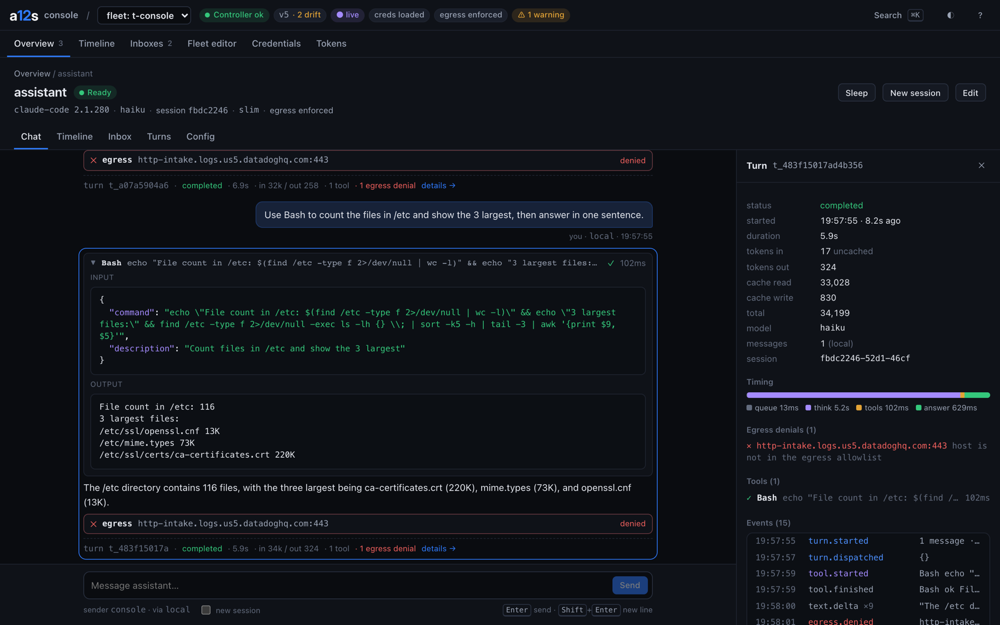
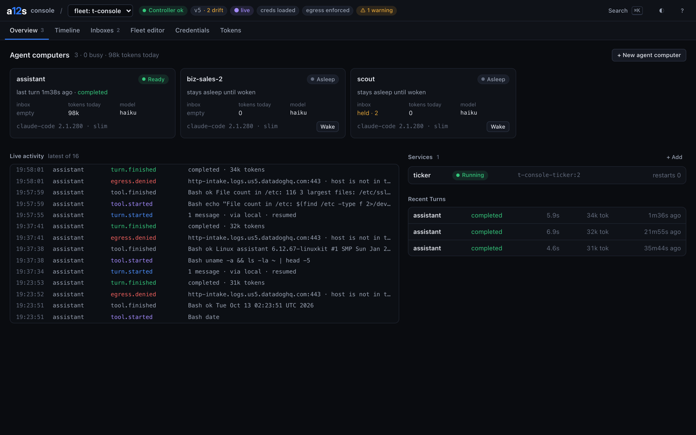
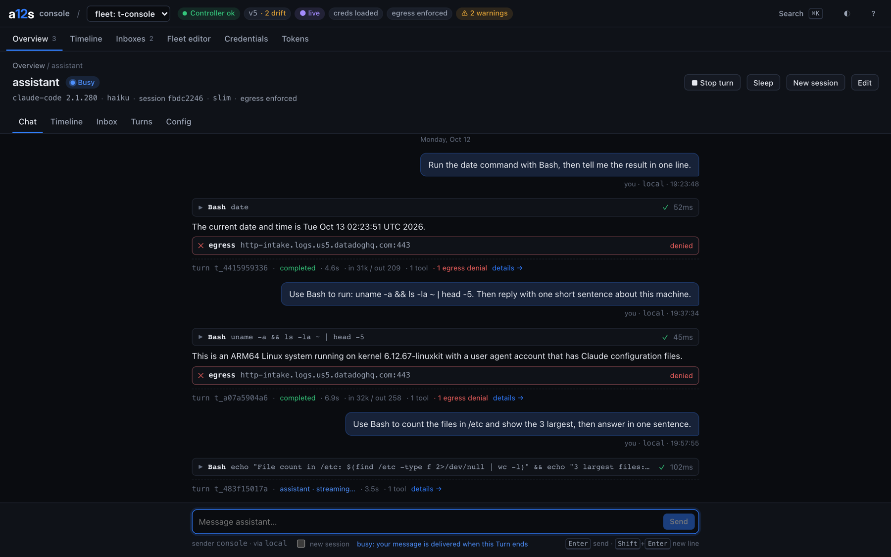
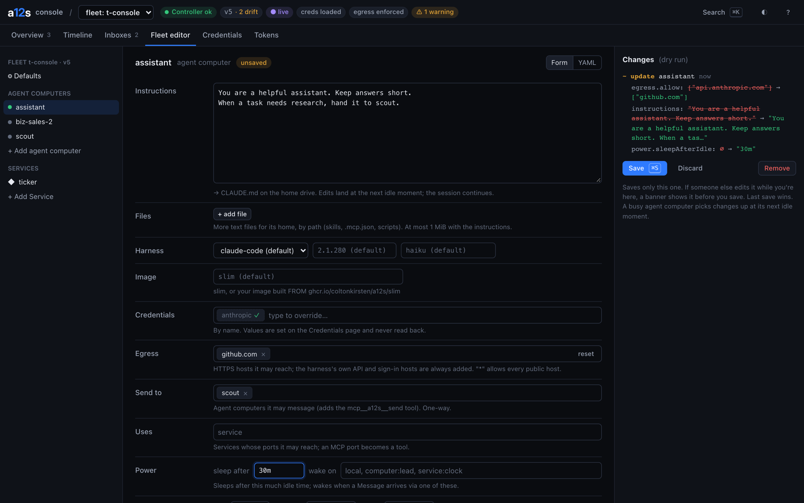
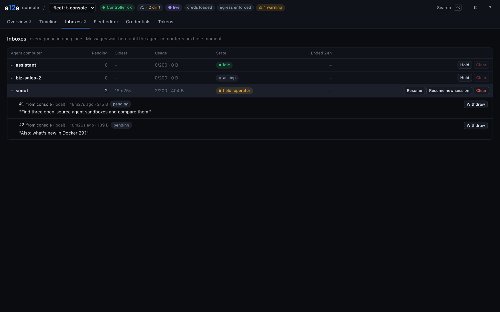
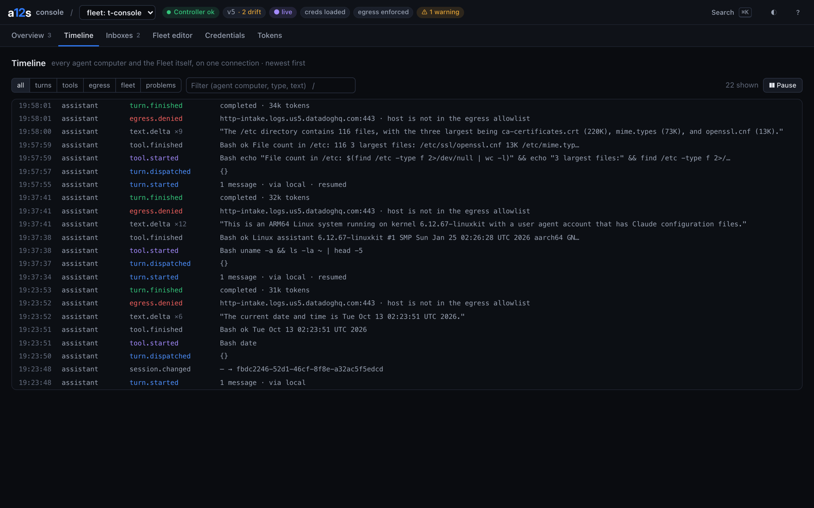
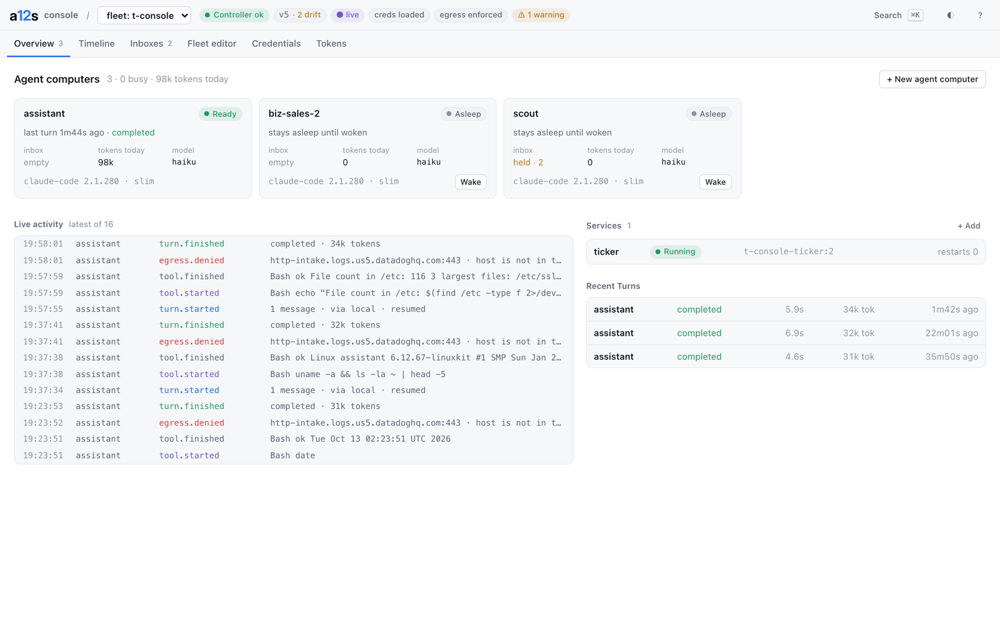

# a12s console

Chrome DevTools for [a12s](https://github.com/coltonkirsten/a12s): watch your agent computers work, chat with them, and edit the Fleet, from one local web page.



```sh
a12s ui                                    # a12s 0.4.1+: opens the console for the Fleet you're in
npx github:coltonkirsten/a12s-console      # the same, without the a12s CLI
```

It finds every running Fleet on this machine (`~/.a12s/<fleet>/controller.json`, written by `a12s up`), prints a link with a one-time key and opens your browser. Needs Node.js 20+.

## What's in it

- **Overview**: a card per agent computer (phase, the Turn it's on, inbox, tokens today, warnings with a fix), Services, live activity and recent Turns.
- **Agent computer**: a **chat** with your messages, the agent's replies and every tool call inline (click to expand input and output), egress denials where they happened, and a footer per Turn with timing and tokens. Tabs for its **timeline**, **inbox**, **Turns** and **config**. Stop, sleep, wake and start a new session from the header.
- **Turn details**: status, timing split into queue / think / tools / answer, normalized tokens (in, out, cache read, cache write), errors, egress denials, every event, raw JSON and "copy as curl".
- **Timeline**: the whole Fleet on one connection, filterable (turns, tools, egress, fleet changes, problems), pausable.
- **Inboxes**: every queue in one table. Hold, resume (in a new session), clear, and withdraw single Messages.
- **Fleet editor**: add, edit and remove agent computers and Services. Instructions inline, files, harness, image, credentials by name, egress, grants, uses, power, resources and the seccomp profile, with values from Defaults shown in grey. Form or YAML. Every edit is checked by the Controller as you type (`?dryRun=true`) and shows the change as `before → after` before you save.
- **Credentials**: set or replace by name. Values are write-only; nobody can read one back.
- **Tokens**: create a prefix lane (`biz-` gets owner powers on `biz-*` only) or a narrow token, see when each was last used, revoke.

Keyboard: `⌘K` go to anything, `g o / t / i / e / c / k` pages, `1`–`5` tabs, `/` focus, `⌘S` save, `?` all shortcuts. Dark and light (follows the system; `Shift T` cycles).

| | |
|---|---|
|  Overview |  Chat while a Turn streams |
|  Fleet editor, dry run before → after |  Inboxes |
|  Timeline |  Light theme |

## Security

The console acts as the Fleet's **owner**, so it is local only:

- It listens on 127.0.0.1 and answers only loopback `Host` names (a hostile page can't reach it by rebinding a domain).
- Every request needs this run's key. The link's `?key=` is traded once for an `HttpOnly; SameSite=Strict` cookie and removed from the address bar. A new key each run.
- Cross-origin writes are refused. The owner token stays in the Node process; the browser never sees it.

To give other people access, don't expose the console: run your own server with login and a scoped token (`a12s token create web --prefix web-`).

## Options

```text
a12s-console [--fleet <name>] [--port 7013] [--host 127.0.0.1] [--no-open] [--url URL --token TOKEN]
```

`a12s ui` passes its arguments through: `a12s ui --port 8000 --no-open`.

## Built on the public API only

Everything goes through the [TypeScript SDK](https://www.npmjs.com/package/@coltonkirsten/a12s) and the Controller's HTTP API: one fleet-wide event stream (`GET /v1/events`), past Turns, inboxes, per-item writes with `?dryRun`, credentials and tokens. When the console needed something the API didn't have, it was added to a12s for every app (a12s 0.4.1: `inbox.changed` and `service.phase` events, before/after values in change lists, credential and token times, a stable Controller port). On an older Controller the console still works and polls instead.

## Develop

```sh
npm install
npm run build && npm start      # serves dist/ on 7013
npm run dev                     # Vite on 5173, API through a console on 7013 (open 7013's key link first)
npm test                        # the server's security checks
```

Vite + React + TypeScript, no component library. `dist/` is committed so `npx github:…` runs without a build; CI checks it is current.

MIT
